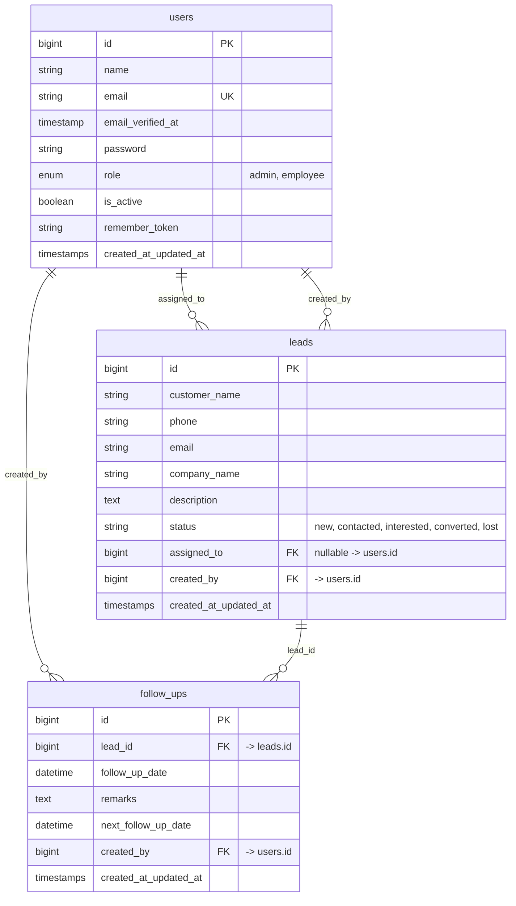

# LeadFlow — Complete Project Documentation & Progress

**Project Title:** LeadFlow — Web-Based Lead Management System  
**Academic Context:** MCA 2nd Year Mini Project  
**Current Date:** November 12, 2026  
**Architecture:** Decoupled Monorepo (`backend/` + `frontend/`)  
**Completed Milestones:** Steps 1, 2, 3, 4, 5, 6, 7, 8, 9, and 10

---

## 1. Project Technology Stack & Environment

| Layer | Technology | Version / Configuration | Purpose |
| :--- | :--- | :--- | :--- |
| **Backend Framework** | Laravel | 12.x (PHP 8.2+) | Core REST API backend |
| **API Authentication** | Laravel Sanctum | 4.x | Token-based API authentication |
| **Database** | MySQL | `leadflow_db` on `127.0.0.1:3306` | Relational data persistence |
| **Frontend Framework** | React | 19.x with Vite 8.x | Single Page Application (SPA) |
| **Routing** | React Router | 7.x | Client-side routing and route guarding |
| **Styling & UI** | Bootstrap & Bootstrap Icons | 5.3.8 & 1.13.2 | Responsive UI system (Theme: `#434AFA`) |
| **HTTP Client** | Axios | 1.21.x | Centralized API client with interceptors |

---

## 2. Summary of Completed Steps

### Step 1: Project Setup & Health Verification
- [x] Initialized decoupled frontend and backend project repositories.
- [x] Configured CORS in Laravel to accept incoming requests from frontend origins.
- [x] Configured Axios client with base URL pointing to Laravel's `/api`.
- [x] Created `GET /api/health` connectivity check verifying client-server communication.

### Step 2: Database Design, Migrations, Models & Seeders
- [x] Created MySQL database `leadflow_db` with `utf8mb4_unicode_ci`.
- [x] Implemented strictly **three main business tables**: `users`, `leads`, and `follow_ups` (no redundant extra tables).
- [x] Built Eloquent models with relationship methods, fillable fields, date casting, and lead status constants.
- [x] Created idempotent `DatabaseSeeder.php` with 1 Admin account, 2 Employee accounts, 5 Leads (covering all 5 statuses), and 4 Follow-Ups.
- [x] Validated table integrity and relationship cascades.

### Step 3: Authentication & Role-Based Access Control (RBAC)
- [x] Created `AuthController` handling `login`, `logout`, and authenticated `user` endpoints.
- [x] Enforced active account status check (`is_active`) on login.
- [x] Created `CheckRole` middleware alias (`role:admin`, `role:employee`) returning HTTP 403 on permission mismatch.
- [x] Protected test endpoints created: `GET /api/admin/test` and `GET /api/employee/test`.
- [x] Created frontend `AuthContext` with session persistence, automatic token restoration, and reactive state.
- [x] Created `ProtectedRoute` and `PublicRoute` route guards enforcing role restrictions and redirects.
- [x] Built responsive `LoginPage` with LeadFlow brand color `#434AFA`, show/hide password, and validation error alerts.
- [x] Verified 13 backend authentication test cases and executed frontend production build without errors.

### Step 4: Lead Management CRUD APIs & Authorization
- [x] Created `LeadController` providing complete RESTful operations (`index`, `store`, `show`, `update`, `destroy`).
- [x] Created Form Requests (`StoreLeadRequest`, `UpdateLeadRequest`) validating status, phone, customer name, and restricting employee assignments to active employees.
- [x] Created `LeadResource` protecting sensitive information and eager-loading creator and assigned employee relationships.
- [x] Enforced strict role-based data isolation:
  - Admin: Can view, create, update, reassign, filter by employee, and delete any lead.
  - Employee: Can view, create, and update only leads assigned to themselves; cannot reassign, view other employees' leads, or delete leads.
- [x] Implemented search (`search`), status filter (`status`), employee filter (`assigned_to`), and pagination (`page`, `per_page`).
- [x] Created automated test suite (`tests/Feature/LeadCrudTest.php`) verifying all 15 scenarios.

### Step 5: Follow-Up Management REST APIs & Authorization
- [x] Created `FollowUpController` providing endpoints:
  - `GET /api/follow-ups` (paginated listing with search, lead filter, and creator filter)
  - `POST /api/follow-ups` (create follow-up with validation)
  - `GET /api/follow-ups/{id}` (view individual follow-up)
  - `PUT/PATCH /api/follow-ups/{id}` (update remarks and dates; immutable lead/creator)
  - `DELETE /api/follow-ups/{id}` (delete follow-up, Admin only)
  - `GET /api/leads/{leadId}/follow-ups` (lead-specific follow-up history)
- [x] Created Form Requests (`StoreFollowUpRequest`, `UpdateFollowUpRequest`) ensuring valid dates, existing leads, and assigned lead restrictions.
- [x] Created `FollowUpResource` standardizing API output and sanitizing nested relations.
- [x] Enforced strict ownership rules:
  - Admin: Can view, create, update, and delete any follow-up on any lead.
  - Employee: Can view/add follow-ups only for leads currently assigned to them; can edit only their own follow-ups while the lead remains assigned to them; cannot delete follow-ups or modify `lead_id`/`created_by`.
- [x] Created automated test suite (`tests/Feature/FollowUpCrudTest.php`) covering 17 scenarios.

### Step 6: Dashboard Statistics & Overview APIs (Backend)
- [x] Created `DashboardController` providing:
  - `GET /api/dashboard/summary` (aggregated lead status counts & follow-ups due today, overdue, and upcoming within 7 days in single-query optimization).
  - `GET /api/dashboard/follow-ups` (scheduled follow-ups filtered by `period=today|upcoming|overdue` with pagination).
  - `GET /api/dashboard/recent-leads` (latest 5 leads).
- [x] Enforced role-based data scoping:
  - Admin: Aggregates metrics and records system-wide across all leads and employees.
  - Employee: Scopes metrics and lists strictly to leads assigned to their authenticated user ID.
- [x] Created automated test suite (`tests/Feature/DashboardTest.php`) covering 14 scenarios with controlled test dates (`Carbon::setTestNow()`).
- [x] Verified full backend suite (48 tests passing).

### Step 7: Frontend Application Layout & Dashboard UI
- [x] Built professional CRM-style sidebar layout in [`AppLayout.jsx`](file:///c:/laravel/LeadFlow/frontend/src/layouts/AppLayout.jsx) with fixed `250px` width, mobile offcanvas drawer, role badges, active navigation indicators, and sign-out buttons.
- [x] Implemented responsive top navigation bar showing current page title, authenticated user name, user role, and avatar.
- [x] Created reusable UI components:
  - [`StatCard.jsx`](file:///c:/laravel/LeadFlow/frontend/src/components/StatCard.jsx): Displays metrics with custom icons, accent colors, and subtitles.
  - [`StatusBadge.jsx`](file:///c:/laravel/LeadFlow/frontend/src/components/StatusBadge.jsx): Formatted badges with icons for all 5 lead statuses (`new`, `contacted`, `interested`, `converted`, `lost`).
  - [`RecentLeadsTable.jsx`](file:///c:/laravel/LeadFlow/frontend/src/components/RecentLeadsTable.jsx): Formatted responsive table with customer contact info, company, status badge, assigned staff, and created date.
  - [`FollowUpListCard.jsx`](file:///c:/laravel/LeadFlow/frontend/src/components/FollowUpListCard.jsx): Multi-tab card (`Due Today`, `Upcoming (7 Days)`, `Overdue`) with real-time fetching, overdue alerts, and remarks preview.
- [x] Created dedicated dashboards:
  - [`AdminDashboardPage.jsx`](file:///c:/laravel/LeadFlow/frontend/src/pages/AdminDashboardPage.jsx): System-wide lead pipeline overview, all 6 status distributions, and team follow-up reminders.
  - [`EmployeeDashboardPage.jsx`](file:///c:/laravel/LeadFlow/frontend/src/pages/EmployeeDashboardPage.jsx): Personal pipeline workspace displaying only self-assigned leads and relevant follow-ups.
- [x] Corrected layout overlapping and viewport clipping issues, ensuring flawless responsive behavior across screen sizes.

### Step 8: Frontend Lead Management Module
- [x] Created [`leadService.js`](file:///c:/laravel/LeadFlow/frontend/src/services/leadService.js) managing all lead API requests via centralized Axios instance.
- [x] Replaced placeholder pages with functional [`LeadsPage.jsx`](file:///c:/laravel/LeadFlow/frontend/src/pages/LeadsPage.jsx) for both `/admin/leads` and `/employee/leads`.
- [x] Implemented responsive lead table with customer name, phone, email, company, status badge, creation date, and action buttons.
- [x] Added debounced search (350ms) across customer name, phone, and email.
- [x] Added status dropdown filter (`All`, `New`, `Contacted`, `Interested`, `Converted`, `Lost`).
- [x] Added Admin-only employee assignment filter including `Unassigned Leads`.
- [x] Implemented server-side pagination with total record count and previous/next page navigation.
- [x] Created [`LeadFormModal.jsx`](file:///c:/laravel/LeadFlow/frontend/src/components/LeadFormModal.jsx) supporting both Create and Edit lead workflows with validation error displays. Allowed Admins to assign/reassign employees; hid assignment controls from Employees (auto-assigned by backend).
- [x] Created [`LeadDetailModal.jsx`](file:///c:/laravel/LeadFlow/frontend/src/components/LeadDetailModal.jsx) displaying customer details, notes, assigned staff, creator info, and formatted timestamps.
- [x] Created [`DeleteConfirmModal.jsx`](file:///c:/laravel/LeadFlow/frontend/src/components/DeleteConfirmModal.jsx) enabling Admins to permanently delete leads with cascading follow-up warnings (strictly hidden from Employees).

### Step 9: Frontend Follow-Up Management Module
- [x] Created [`followUpService.js`](file:///c:/laravel/LeadFlow/frontend/src/services/followUpService.js) managing all follow-up API interactions (`getFollowUps`, `getFollowUp`, `createFollowUp`, `updateFollowUp`, `deleteFollowUp`, `getLeadFollowUps`).
- [x] Built functional [`FollowUpsPage.jsx`](file:///c:/laravel/LeadFlow/frontend/src/pages/FollowUpsPage.jsx) for both `/admin/follow-ups` and `/employee/follow-ups`.
- [x] Implemented schedule filter pills:
  - `All Records`
  - `Due Today`
  - `Upcoming (7 Days)`
  - `Overdue Reminders`
- [x] Added debounced search across customer name, phone, and remarks, plus lead dropdown filter and Admin creator filter.
- [x] Created [`FollowUpFormModal.jsx`](file:///c:/laravel/LeadFlow/frontend/src/components/FollowUpFormModal.jsx) supporting both Create and Edit follow-ups with role-scoped lead dropdowns and datetime-local formatters. Enforced immutability of `lead_id` and creator during edit.
- [x] Created [`FollowUpDetailModal.jsx`](file:///c:/laravel/LeadFlow/frontend/src/components/FollowUpDetailModal.jsx) showing linked prospect details, conversation summary, and schedule timestamps.
- [x] Created [`DeleteFollowUpModal.jsx`](file:///c:/laravel/LeadFlow/frontend/src/components/DeleteFollowUpModal.jsx) for Admin deletion confirmation. Hidden from Employees.
- [x] Updated [`LeadDetailModal.jsx`](file:///c:/laravel/LeadFlow/frontend/src/components/LeadDetailModal.jsx) with a chronological **Follow-Up History & Timeline** section loading records via `GET /api/leads/{id}/follow-ups`.
- [x] Updated router in [`App.jsx`](file:///c:/laravel/LeadFlow/frontend/src/App.jsx) pointing `/admin/follow-ups` and `/employee/follow-ups` directly to `FollowUpsPage`.
- [x] Confirmed zero regressions across backend test suite (48 passed), frontend production build (1.42s, 0 errors), and linter (0 errors).

### Step 10: Admin User & Employee Management Module
- [x] Reused the existing `users` table without adding any unnecessary tables (`employees`, `departments`, etc.).
- [x] Strictly enforced **no permanent deletion** rule to preserve foreign-key relational integrity across `leads` and `follow_ups`. Instead, implemented account deactivation via `is_active`.
- [x] Created backend Form Requests:
  - `StoreEmployeeRequest.php`: Validates name, unique email, confirmed password min:6, and `is_active`.
  - `UpdateEmployeeRequest.php`: Validates name, unique email ignoring target user, optional confirmed password, and `is_active`.
- [x] Created `UserResource.php` exposing `id`, `name`, `email`, `role`, `is_active`, `created_at`, and `updated_at`, while strictly omitting `password` and `remember_token`.
- [x] Created `EmployeeController.php` under `app/Http/Controllers/Api/Admin/` implementing:
  - `GET /api/admin/employees`: Paginated listing with search (`name`, `email`), `is_active` filter, scoping strictly to `role='employee'`.
  - `POST /api/admin/employees`: Creates employee account forcing `role='employee'`.
  - `GET /api/admin/employees/{id}`: Returns employee profile details.
  - `PUT/PATCH /api/admin/employees/{id}`: Updates employee info, password (if provided), and `is_active` status without allowing role privilege escalation.
- [x] Created 20 comprehensive feature tests in `tests/Feature/EmployeeManagementTest.php` covering access controls, CRUD operations, password reset, deactivation/reactivation, login blocking, and FK history retention. All 68 backend tests pass.
- [x] Created frontend `employeeService.js` handling API communication.
- [x] Created `EmployeesPage.jsx` with search, active/inactive filters, table display, server-side pagination, and action controls.
- [x] Created `EmployeeFormModal.jsx` for creating and editing employee accounts with password toggle and validation error rendering.
- [x] Created `EmployeeDetailModal.jsx` displaying full staff member details.
- [x] Created Deactivate/Activate confirmation dialog with data preservation guarantees.
- [x] Updated `AppLayout.jsx` sidebar to display "Employees" nav item exclusively for Admins.
- [x] Updated `App.jsx` routing to include `/admin/employees` protected by `role:admin`.
- [x] Updated `LeadsPage.jsx` so that Admin lead assignments dynamically pull live, active employee accounts via `employeeService.getEmployees({ is_active: true })`.

---

## 3. Database Architecture & Schema Details

Strictly adhering to project requirements, **only three main business tables** exist. No extra tables (`lead_statuses`, `lead_sources`, `notes`, etc.) were introduced.



### Table Definitions

#### 1. `users` Table
- **Migration:** `database/migrations/0001_01_01_000000_create_users_table.php`
- Fields:
  - `id`: BigInt Unsigned, Primary Key, Auto Increment
  - `name`: String (255)
  - `email`: String (255), Unique
  - `email_verified_at`: Timestamp, Nullable
  - `password`: String (255)
  - `role`: Enum (`'admin'`, `'employee'`), Default `'employee'`
  - `is_active`: Boolean (`tinyint(1)`), Default `true`
  - `remember_token`: String, Nullable
  - `created_at`, `updated_at`: Timestamps

#### 2. `leads` Table
- **Migration:** `database/migrations/2026_10_31_120000_create_leads_table.php`
- Fields:
  - `id`: BigInt Unsigned, Primary Key, Auto Increment
  - `customer_name`: String (255), Indexed
  - `phone`: String (255), Indexed
  - `email`: String (255), Nullable
  - `company_name`: String (255), Nullable
  - `description`: Text, Nullable
  - `status`: String (255), Default `'new'`, Indexed *(Allowed: `new`, `contacted`, `interested`, `converted`, `lost`)*
  - `assigned_to`: Foreign Key referencing `users.id`, Nullable, Indexed, `onDelete('set null')`
  - `created_by`: Foreign Key referencing `users.id`, Indexed, `onDelete('cascade')`
  - `created_at`, `updated_at`: Timestamps, `created_at` Indexed

#### 3. `follow_ups` Table
- **Migration:** `database/migrations/2026_10_31_130000_create_follow_ups_table.php`
- Fields:
  - `id`: BigInt Unsigned, Primary Key, Auto Increment
  - `lead_id`: Foreign Key referencing `leads.id`, Indexed, `onDelete('cascade')`
  - `follow_up_date`: DateTime, Indexed
  - `remarks`: Text
  - `next_follow_up_date`: DateTime, Nullable, Indexed
  - `created_by`: Foreign Key referencing `users.id`, Indexed, `onDelete('cascade')`
  - `created_at`, `updated_at`: Timestamps

---

## 4. Eloquent Models & Relationship Mapping

### A. `User` Model (`app/Models/User.php`)
- **Mass assignable (`$fillable`):** `['name', 'email', 'password', 'role', 'is_active']`
- **Hidden fields:** `['password', 'remember_token']`
- **Casts:** `password => 'hashed'`, `is_active => 'boolean'`, `email_verified_at => 'datetime'`
- **Relationships:**
  - `assignedLeads()`: `hasMany(Lead::class, 'assigned_to')`
  - `createdLeads()`: `hasMany(Lead::class, 'created_by')`
  - `createdFollowUps()`: `hasMany(FollowUp::class, 'created_by')`

### B. `Lead` Model (`app/Models/Lead.php`)
- **Status Constants:**
  - `Lead::STATUS_NEW = 'new'`
  - `Lead::STATUS_CONTACTED = 'contacted'`
  - `Lead::STATUS_INTERESTED = 'interested'`
  - `Lead::STATUS_CONVERTED = 'converted'`
  - `Lead::STATUS_LOST = 'lost'`
  - `Lead::ALLOWED_STATUSES = ['new', 'contacted', 'interested', 'converted', 'lost']`
- **Mass assignable (`$fillable`):** `['customer_name', 'phone', 'email', 'company_name', 'description', 'status', 'assigned_to', 'created_by']`
- **Relationships:**
  - `assignedEmployee()`: `belongsTo(User::class, 'assigned_to')`
  - `creator()`: `belongsTo(User::class, 'created_by')`
  - `followUps()`: `hasMany(FollowUp::class, 'lead_id')`

### C. `FollowUp` Model (`app/Models/FollowUp.php`)
- **Table:** Explicitly set to `'follow_ups'`
- **Mass assignable (`$fillable`):** `['lead_id', 'follow_up_date', 'remarks', 'next_follow_up_date', 'created_by']`
- **Casts:** `follow_up_date => 'datetime'`, `next_follow_up_date => 'datetime'`
- **Relationships:**
  - `lead()`: `belongsTo(Lead::class, 'lead_id')`
  - `creator()`: `belongsTo(User::class, 'created_by')`

---

## 5. Seeded Accounts & Sample Data

Available in the database via `php artisan db:seed`:

### Users
| ID | Name | Email | Password | Role | Status |
| :--- | :--- | :--- | :--- | :--- | :--- |
| **1** | LeadFlow Admin | `admin@leadflow.test` | `password123` | `admin` | Active |
| **2** | Rahul Sharma | `rahul.sharma@leadflow.test` | `password123` | `employee` | Active |
| **3** | Priya Patel | `priya.patel@leadflow.test` | `password123` | `employee` | Active |

### Sample Leads
| ID | Customer Name | Phone | Email | Company | Status | Assigned To | Created By |
| :--- | :--- | :--- | :--- | :--- | :--- | :--- | :--- |
| **1** | Aarav Mehta | `+91 98765 43210` | `aarav.mehta@example.com` | Apex Cloud Innovations | `new` | Rahul Sharma | Admin |
| **2** | Sunita Rao | `+91 98220 11223` | `sunita.rao@techcraft.in` | TechCraft Solutions | `contacted` | Priya Patel | Admin |
| **3** | Vikram Singhania | `+91 97110 99887` | `vikram@singhaniagroup.com` | Singhania Logistics | `interested` | Rahul Sharma | Rahul Sharma |
| **4** | Deepak Verma | `+91 99001 55443` | `deepak.verma@finflow.co` | FinFlow Advisory | `converted` | Priya Patel | Admin |
| **5** | Neha Kapoor | `+91 98450 67890` | `neha.kapoor@retailhub.org` | RetailHub Systems | `lost` | *Unassigned* | Priya Patel |

### Follow-Up History
| ID | Lead | Created By | Follow-up Date | Next Date | Remarks |
| :--- | :--- | :--- | :--- | :--- | :--- |
| **1** | Sunita Rao | Priya Patel | -2 Days | +3 Days | Initiated discovery call. Discussed workflow requirements. |
| **2** | Vikram Singhania | Rahul Sharma | -1 Day | +2 Days | Shared custom enterprise tier pricing proposal via email. |
| **3** | Vikram Singhania | Rahul Sharma | Today | +5 Days | Procurement team confirmed SLA review. Final sign-off scheduled. |
| **4** | Deepak Verma | Priya Patel | -4 Days | None | Completed onboarding session and handed over account credentials. |

---

## 6. API Endpoints Directory (All 20 Registered Routes)

All endpoints are prefixed with `/api`.

| Method | Endpoint | Authorization | Description |
| :--- | :--- | :--- | :--- |
| **GET** | `/api/health` | Public | System status and connectivity check |
| **POST** | `/api/login` | Public | Validates credentials, checks `is_active`, issues Sanctum token, returns user profile |
| **POST** | `/api/logout` | `auth:sanctum` | Revokes the current access token |
| **GET** | `/api/user` | `auth:sanctum` | Returns authenticated user profile |
| **GET** | `/api/admin/test` | `auth:sanctum`, `role:admin` | Role-protected admin test route |
| **GET** | `/api/employee/test` | `auth:sanctum`, `role:employee` | Role-protected employee test route |
| **GET** | `/api/dashboard/summary` | `auth:sanctum` | Overall lead counts by status & scheduled follow-up metrics |
| **GET** | `/api/dashboard/follow-ups` | `auth:sanctum` | Paginated list of scheduled follow-ups (`today`, `upcoming`, `overdue`) |
| **GET** | `/api/dashboard/recent-leads` | `auth:sanctum` | Recent leads list (default 5) |
| **GET** | `/api/leads` | `auth:sanctum` | Paginated listing with search and filters (Admin sees all; Employee sees only assigned) |
| **POST** | `/api/leads` | `auth:sanctum` | Create a lead (Admin can assign; Employee auto-assigned to self) |
| **GET** | `/api/leads/{id}` | `auth:sanctum` | View single lead (Employee restricted to assigned leads) |
| **PUT/PATCH**| `/api/leads/{id}` | `auth:sanctum` | Update lead (Admin can reassign; Employee can update assigned leads) |
| **DELETE**| `/api/leads/{id}` | `auth:sanctum`, Admin only | Permanently delete lead and cascade associated follow-ups |
| **GET** | `/api/leads/{leadId}/follow-ups` | `auth:sanctum` | View follow-up history for a specific lead |
| **GET** | `/api/follow-ups` | `auth:sanctum` | Paginated list with search and filters (Admin sees all; Employee sees assigned) |
| **POST** | `/api/follow-ups` | `auth:sanctum` | Create follow-up (Admin for any lead; Employee for assigned lead only) |
| **GET** | `/api/follow-ups/{id}` | `auth:sanctum` | View single follow-up details |
| **PUT/PATCH**| `/api/follow-ups/{id}` | `auth:sanctum` | Update follow-up (Admin any; Employee can edit own while lead is assigned) |
| **DELETE**| `/api/follow-ups/{id}` | `auth:sanctum`, Admin only | Permanently delete follow-up record |
| **GET** | `/api/admin/employees` | `auth:sanctum`, `role:admin` | Paginated listing of employees with search and status filters |
| **POST** | `/api/admin/employees` | `auth:sanctum`, `role:admin` | Create new employee user account |
| **GET** | `/api/admin/employees/{id}` | `auth:sanctum`, `role:admin` | View single employee profile |
| **PUT/PATCH**| `/api/admin/employees/{id}` | `auth:sanctum`, `role:admin` | Update employee profile, change password, activate/deactivate |

---

## 7. Frontend Route Architecture

| Route Path | Access Level | Component | Description |
| :--- | :--- | :--- | :--- |
| `/login` | Public | `LoginPage` | LeadFlow sign-in screen (redirects if already logged in) |
| `/admin/dashboard` | Protected (`admin`) | `AdminDashboardPage` | Full system-wide overview, metrics, reminders, and recent leads |
| `/admin/leads` | Protected (`admin`) | `LeadsPage` | Complete Lead CRUD table, employee filter, modal editors & deleter |
| `/admin/follow-ups` | Protected (`admin`) | `FollowUpsPage` | Complete Follow-up CRUD table, schedule filters, modal editors & deleter |
| `/admin/employees` | Protected (`admin`) | `EmployeesPage` | Admin employee management: search, filters, create/edit, reset password, deactivation |
| `/employee/dashboard`| Protected (`employee`)| `EmployeeDashboardPage` | Personal employee workspace for assigned leads & tasks |
| `/employee/leads` | Protected (`employee`)| `LeadsPage` | Employee assigned leads directory with create/edit/view features |
| `/employee/follow-ups`| Protected (`employee`)| `FollowUpsPage` | Employee assigned follow-ups directory with create/edit/view features |
| `/` & `*` | Any | Redirect to `/login` | Fallback navigation |

---

## 8. Role-Based Access Control (RBAC) & Permission Matrix

| Feature / Action | Admin | Employee |
| :--- | :--- | :--- |
| **Access Admin Area** | Allowed | Forbidden (HTTP 403 / Redirected) |
| **Access Employee Area** | Forbidden (HTTP 403 / Redirected) | Allowed |
| **Dashboard Summary (`/dashboard/summary`)** | System-wide statistics for all leads & follow-ups | Scoped strictly to leads assigned to own user ID |
| **Dashboard Follow-Ups (`/dashboard/follow-ups`)** | Scheduled follow-ups across all leads | Scheduled follow-ups for assigned leads only |
| **Dashboard Recent Leads (`/dashboard/recent-leads`)** | Latest leads across the entire system | Latest leads assigned to own user ID |
| **View Leads List** | All leads across the system | Only leads assigned to own ID |
| **Filter Leads by Employee** | Supported (`?assigned_to=<id>` or `unassigned`) | Hidden & ignored; scoped to self |
| **Create Lead** | Assign to any active employee or `null` | Auto-assigned to self (assignment input hidden) |
| **View Individual Lead** | Any lead ID | Own assigned leads only (403 if other) |
| **Update Lead Details** | Any lead ID | Own assigned leads only (403 if other) |
| **Reassign Lead** | Allowed to any active employee or `null` | Forbidden; assignment dropdown hidden |
| **Delete Lead** | Allowed with confirmation dialog (HTTP 200) | Strictly Forbidden; action button hidden |
| **View Follow-Ups List** | All follow-ups across the system | Only follow-ups on assigned leads |
| **Filter Follow-Ups by Creator**| Supported (`?created_by=<id>`) | Hidden & ignored; scoped to assigned leads |
| **Filter Follow-Ups by Schedule**| Supported (`All`, `Today`, `Upcoming`, `Overdue`) | Supported (`All`, `Today`, `Upcoming`, `Overdue`) |
| **Create Follow-Up** | On any existing lead | On assigned leads only (422 if other/unassigned) |
| **Set Follow-Up `created_by`** | Automatically set to Admin ID | Automatically set to Employee ID |
| **View Single Follow-Up** | Any follow-up ID | Only if lead is assigned to them (403 if other) |
| **View Lead Follow-Up History**| Any lead ID | Only if lead is assigned to them (403 if other) |
| **Edit Follow-Up** | Any follow-up ID | Only own follow-ups while lead is assigned (403 if other) |
| **Change `lead_id` or `created_by`**| Immutable | Immutable (stripped from request) |
| **Delete Follow-Up** | Allowed (HTTP 200) | Forbidden (HTTP 403) |
| **Manage Employees (`/admin/employees`)**| Full access (Create, View, Edit, Activate/Deactivate, Reset Passwords)| Forbidden (HTTP 403 / Redirected) |
| **Deactivate / Reactivate Staff** | Allowed (Disables login & assignments; preserves lead/follow-up FK history) | Forbidden |

---

## 9. Automated Testing & Verification Suite

All unit and feature test suites run clean via `php artisan test`:

```text
PASS  Tests\Unit\ExampleTest
✓ that true is true

PASS  Tests\Feature\ExampleTest
✓ the application returns a successful response

PASS  Tests\Feature\DashboardTest (14 tests)
✓ unauthenticated users cannot access dashboard endpoints
✓ admin can retrieve system wide dashboard statistics
✓ employee sees only assigned leads in dashboard statistics
✓ lead status counts are correct
✓ follow ups due today are counted correctly
✓ overdue follow ups are counted correctly
✓ upcoming follow ups within 7 days are counted correctly
✓ null next follow up dates are excluded
✓ admin can retrieve all dashboard follow ups
✓ employee cannot retrieve other employees follow ups
✓ admin can retrieve all recent leads
✓ employee sees only assigned recent leads
✓ invalid period returns 422
✓ empty database returns zero counts and empty lists

PASS  Tests\Feature\LeadCrudTest (15 tests)
✓ unauthenticated user cannot access lead apis
✓ admin can retrieve all leads
✓ employee can retrieve only their assigned leads
✓ admin can create a lead
✓ employee creates lead assigned to themselves
✓ employee cannot assign lead to another employee
✓ admin can assign and reassign leads
✓ employee cannot view another employees lead
✓ employee cannot update another employees lead
✓ employee cannot delete leads
✓ admin can update and delete leads
✓ invalid lead status returns 422
✓ invalid employee assignment returns 422
✓ search and status filters work
✓ pagination returns correct results

PASS  Tests\Feature\FollowUpCrudTest (17 tests)
✓ unauthenticated user cannot access follow up apis
✓ admin can view all follow ups
✓ employee can view only follow ups for assigned leads
✓ admin can create a follow up
✓ employee can create a follow up for assigned lead
✓ employee cannot create follow up for another employees lead
✓ employee cannot create follow up for unassigned lead
✓ created by is automatically set to authenticated user
✓ employee cannot change lead id or created by
✓ employee can edit own follow up for assigned lead
✓ employee cannot edit another users follow up
✓ employee cannot edit follow ups after lead is reassigned
✓ employee cannot delete follow ups
✓ admin can edit and delete follow ups
✓ invalid lead ids and dates return 422
✓ lead specific follow up history respects ownership
✓ search filters and pagination work

PASS  Tests\Feature\EmployeeManagementTest (20 tests)
✓ unauthenticated users cannot access employee management
✓ employees receive 403 when accessing employee management
✓ admin can list employees
✓ admin cannot see admin accounts in employee listing
✓ admin can create an employee
✓ duplicate email returns validation error
✓ invalid employee data returns 422
✓ admin can view employee details
✓ admin can update employee details
✓ admin can reset employee passwords
✓ empty password during editing does not change existing password
✓ admin can deactivate an employee
✓ deactivated employee cannot log in
✓ admin can reactivate an employee
✓ employee role cannot be changed
✓ existing leads remain intact after employee deactivation
✓ existing follow ups remain intact after employee deactivation
✓ deactivated employees cannot be assigned new leads
✓ employee cannot modify another employees account
✓ password and remember token are never exposed

Tests:    68 passed (246 assertions)
Duration: 5.39s
```

- **Frontend Production Build**: `npm run build` runs cleanly without errors (`dist/` generated in 1.42s).
- **Linter**: `npm run lint` passes with 0 errors.

---

## 10. Next Steps / Project Roadmap
- [x] **Step 10**: User & Employee Management (Admin CRUD for employee accounts, account deactivation, password reset).
- [ ] **Step 11**: Final Mini Project Viva Preparation, Export Reports, and Codebase Optimization.
