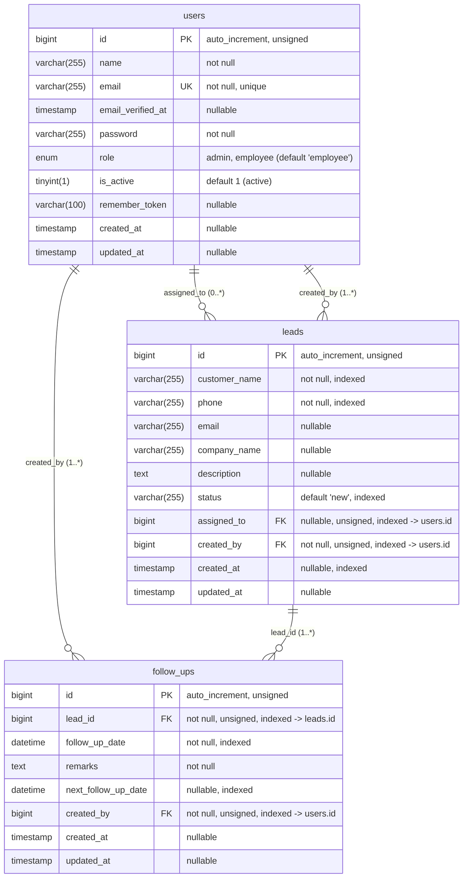

# LeadFlow — Database Schema & Relational Documentation

## 1. Relational Database Overview

LeadFlow uses **MySQL 8.0+** with the `InnoDB` storage engine and `utf8mb4_unicode_ci` charset.

The database design follows strict 3rd Normal Form (3NF) principles, intentionally eliminating redundant tables. The core business domain is represented completely across **three tables**:
1. `users`
2. `leads`
3. `follow_ups`

Sanctum manages token state via the standard `personal_access_tokens` table.

---

## 2. Entity-Relationship (ER) Diagram

---

## 3. Data Dictionary

### Table 1: `users`
Stores system user profiles, role configurations, and access state.

| Column | Type | Nullable | Default | Keys & Indexes | Description |
| :--- | :--- | :--- | :--- | :--- | :--- |
| `id` | BIGINT UNSIGNED | No | Auto Inc | Primary Key | Unique user identifier |
| `name` | VARCHAR(255) | No | None | None | Full legal name of user |
| `email` | VARCHAR(255) | No | None | Unique Index | Work login email address |
| `email_verified_at`| TIMESTAMP | Yes | NULL | None | Email verification timestamp |
| `password` | VARCHAR(255) | No | None | None | Bcrypt hashed password string |
| `role` | ENUM | No | `'employee'`| None | Allowed: `'admin'`, `'employee'` |
| `is_active` | TINYINT(1) | No | `1` | Index | Boolean status (`1`=Active, `0`=Deactivated) |
| `remember_token` | VARCHAR(100) | Yes | NULL | None | Session persistence token |
| `created_at` | TIMESTAMP | Yes | NULL | None | Account creation timestamp |
| `updated_at` | TIMESTAMP | Yes | NULL | None | Last profile update timestamp |

---

### Table 2: `leads`
Stores all customer prospect records throughout their sales pipeline lifecycle.

| Column | Type | Nullable | Default | Keys & Indexes | Description |
| :--- | :--- | :--- | :--- | :--- | :--- |
| `id` | BIGINT UNSIGNED | No | Auto Inc | Primary Key | Unique lead tracking ID |
| `customer_name` | VARCHAR(255) | No | None | Index | Name of prospect contact |
| `phone` | VARCHAR(255) | No | None | Index | Primary contact phone number |
| `email` | VARCHAR(255) | Yes | NULL | None | Contact email address |
| `company_name` | VARCHAR(255) | Yes | NULL | None | Organization or business entity |
| `description` | TEXT | Yes | NULL | None | In-depth notes, requirements, budget |
| `status` | VARCHAR(255) | No | `'new'` | Index | Status: `new`, `contacted`, `interested`, `converted`, `lost` |
| `assigned_to` | BIGINT UNSIGNED | Yes | NULL | Foreign Key, Index | Assigned employee ID (`users.id`). Set null on delete |
| `created_by` | BIGINT UNSIGNED | No | None | Foreign Key, Index | Creator user ID (`users.id`). Cascade on delete |
| `created_at` | TIMESTAMP | Yes | NULL | Index | Inward prospect creation timestamp |
| `updated_at` | TIMESTAMP | Yes | NULL | None | Last status/profile update timestamp |

---

### Table 3: `follow_ups`
Stores individual customer interactions, phone logs, remarks, and scheduled next dates.

| Column | Type | Nullable | Default | Keys & Indexes | Description |
| :--- | :--- | :--- | :--- | :--- | :--- |
| `id` | BIGINT UNSIGNED | No | Auto Inc | Primary Key | Unique follow-up interaction ID |
| `lead_id` | BIGINT UNSIGNED | No | None | Foreign Key, Index | Target lead ID (`leads.id`). Cascade on delete |
| `follow_up_date` | DATETIME | No | None | Index | Timestamp when interaction occurred |
| `remarks` | TEXT | No | None | None | Interaction summary and outcome |
| `next_follow_up_date`| DATETIME | Yes | NULL | Index | Next scheduled follow-up deadline |
| `created_by` | BIGINT UNSIGNED | No | None | Foreign Key, Index | Author staff ID (`users.id`). Cascade on delete |
| `created_at` | TIMESTAMP | Yes | NULL | None | Record creation timestamp |
| `updated_at` | TIMESTAMP | Yes | NULL | None | Record update timestamp |

---

## 4. Foreign Key Constraints & Data Integrity Rules

### Rule 1: Zero Orphan Leads on User Deletion
`leads.assigned_to` specifies `onDelete('set null')`. If a user account was theoretically deleted, any leads assigned to them gracefully revert to `assigned_to = NULL` (Unassigned) rather than being deleted or causing foreign key violation errors.

### Rule 2: Cascade Lead Follow-Ups
`follow_ups.lead_id` specifies `onDelete('cascade')`. When an authorized Administrator deletes a lead record, all nested follow-up entries associated with that lead are automatically and cleanly purged by MySQL, avoiding orphaned interaction logs.

### Rule 3: The Deactivation Rule (Preservation over Deletion)
In production, user records in `users` are **never permanently deleted**. Instead, administrators toggle `users.is_active` to `0`. This guarantees that historical leads and follow-ups retain their valid author foreign keys (`created_by`), ensuring full auditing capabilities while immediately disabling user login and new assignments.

