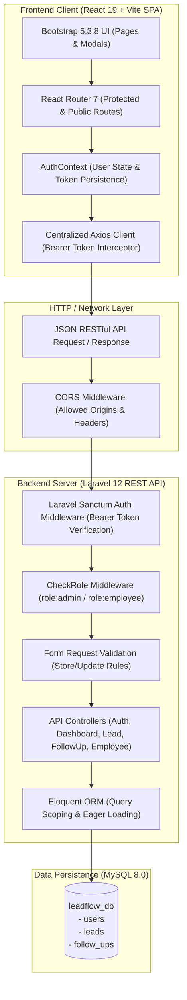
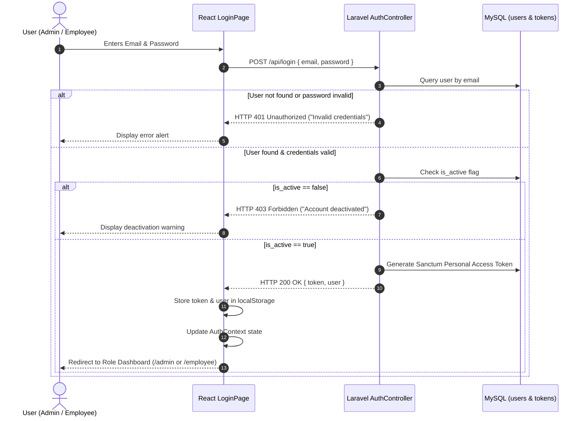

# LeadFlow — System Architecture & Design

## 1. Architectural Overview

LeadFlow uses a **Decoupled Client-Server Architecture** (Stateless REST API + SPA). The frontend (React 19) operates independently from the backend (Laravel 12), communicating strictly via JSON payloads over HTTP.

### System Architecture Diagram

---

## 2. Decoupled Communication & Lifecycle

1. **Client Request:** When a user navigates or interacts with a form, React dispatches an asynchronous API request via a service wrapper (`leadService`, `followUpService`, etc.).
2. **Bearer Token Injection:** The centralized Axios interceptor (`frontend/src/services/api.js`) extracts the Sanctum token from `localStorage` and appends it to the `Authorization: Bearer <token>` header.
3. **CORS Handling:** Laravel validates that the incoming origin (e.g. `http://localhost:5173`) is whitelisted in `config/cors.php`.
4. **Sanctum Authentication:** The `auth:sanctum` middleware validates the Bearer token against `personal_access_tokens` table in MySQL and sets `auth()->user()`.
5. **Role-Based Guard:** The `CheckRole` middleware ensures that users attempting to access admin-only endpoints have `role === 'admin'`.
6. **Form Validation:** Form Request classes validate all payload parameters before controller methods run.
7. **Query Scoping:** The controller applies role scoping (e.g. `$user->isAdmin() ? Lead::query() : Lead::where('assigned_to', $user->id)`).
8. **JSON Transformation:** Eloquent models are formatted into API resources (`LeadResource`, `FollowUpResource`, `UserResource`) hiding sensitive columns (`password`, `remember_token`).
9. **UI Re-render:** React receives the JSON response and updates state without full page reload.

---

## 3. Authentication & Session Flow

---

## 4. Role-Based Access Control (RBAC) Architecture

LeadFlow enforces security at two synchronized levels:

### 1. Frontend Route Guarding (`ProtectedRoute.jsx`)
- Prevents rendering components if user is not authenticated.
- Inspects `user.role`. If user attempts to enter a disallowed route (e.g. Employee navigating to `/admin/employees`), the route guard redirects them to `/employee/dashboard`.
- Dynamically adapts sidebar navigation items in `AppLayout.jsx` (hides "Employees" nav item and Admin-only buttons from Employees).

### 2. Backend Middleware & Query Scoping (Authoritative)
Frontend guards provide UX convenience, but **all security is strictly enforced on the server**:
- `role:admin`: Rejects non-admin API calls with **HTTP 403 Forbidden**.
- Controller-level query constraints ensure employees cannot view, edit, or delete leads assigned to colleagues, even if they forge direct API requests.
- Mass-assignment protections prevent employees from escalating privileges or altering foreign keys.

---

## 5. Database Relational Architecture

The system utilizes an elegant, normalized **3-business-table** architecture:
1. `users` holds identity, credentials, active status, and roles.
2. `leads` holds prospective customer details with foreign keys to `users` for ownership (`created_by`) and current assignment (`assigned_to`).
3. `follow_ups` holds individual interaction records with foreign keys to `leads` (`lead_id`) and `users` (`created_by`).

Refer to `DATABASE_DOCUMENTATION.md` for complete schema definitions.

