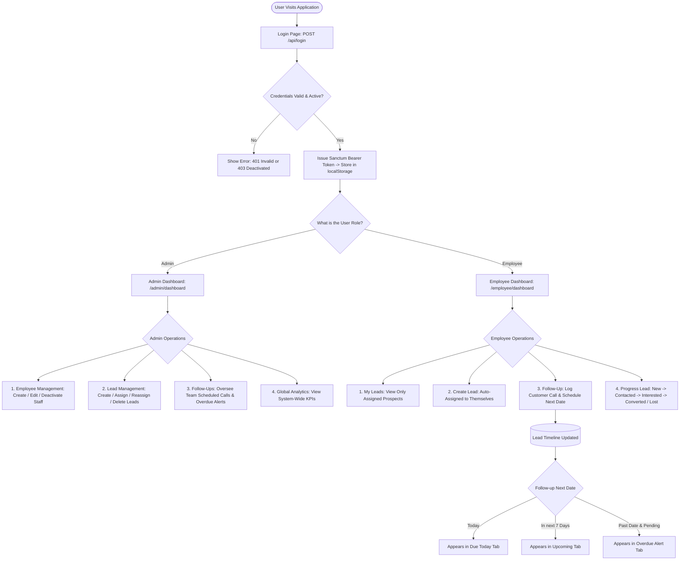
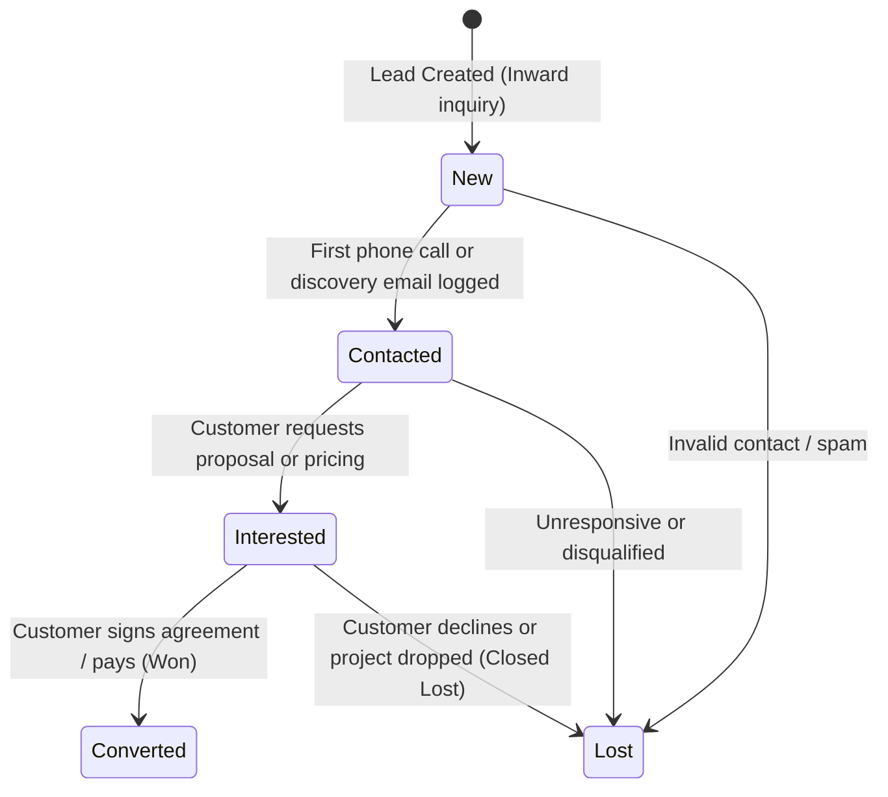

# LeadFlow — Complete End-to-End Workflow Guide

**Project Title:** LeadFlow – Web-Based Lead Management System  
**Academic Degree:** MCA (Master of Computer Applications) — 2nd Year Mini Project  
**Tech Stack:** Laravel 12 REST API + Sanctum + MySQL (`backend/`) | React 19 + Vite + Bootstrap 5.3.8 (`frontend/`)

---

## 1. High-Level System Workflow Diagram

---

## 2. End-to-End Functional Lifecycles

### Lifecycle A: Authentication & Role Authorization
1. **Sign In (`POST /api/login`):**
   - The user enters their email and password.
   - The backend checks whether the email exists and verifies the password hash using `Hash::check()`.
   - **Account Status Guard:** The backend checks `user.is_active`. If false, login is immediately rejected with `403 Forbidden` (*"Your account is deactivated. Contact admin."*).
   - If active, Laravel Sanctum issues a stateless Personal Access Token.
   - The token and user profile are saved in `localStorage`.
2. **Role-Based Navigation:**
   - **Admin:** Routed to `/admin/dashboard`. The sidebar includes **Dashboard, Leads, Follow-Ups, and Employees**.
   - **Employee:** Routed to `/employee/dashboard`. The sidebar includes **Dashboard, Leads, and Follow-Ups** (Employee management is hidden).
3. **API Request Authorization:**
   - On every subsequent request, Axios attaches `Authorization: Bearer <token>`.
   - Backend routes under `role:admin` reject any non-admin token with `403 Forbidden`.

---

### Lifecycle B: Staff & Employee Management (Admin Only)
1. **Creation:** Admin goes to `/admin/employees` and clicks **"Add New Employee"**.
   - Required fields: Name, Email (unique), Password, and Password Confirmation (min: 6 chars).
   - Role is automatically forced to `'employee'`.
2. **Deactivation (Data Preservation Rule):**
   - To revoke access, Admin clicks **Deactivate**.
   - The employee's `is_active` flag is set to `false`.
   - **Result:** The employee is immediately blocked from logging in (HTTP 403) and removed from lead assignment dropdowns.
   - **Relational Integrity:** All leads and past follow-up conversation notes previously handled by this employee remain 100% intact in the database (no orphan or deleted records).
3. **Credential Reset:** Admin can edit an employee and update their password without changing their email or affecting their assigned leads.

---

### Lifecycle C: Lead Pipeline Progression

1. **Inquiry Ingestion (`POST /api/leads`):**
   - Admin creates a lead and assigns it to any active employee (or leaves it `Unassigned`).
   - If an Employee creates a lead, `assigned_to` is automatically forced to their own user ID.
2. **Pipeline Statuses:**
   - `new`: Fresh prospect.
   - `contacted`: Initial outreach completed.
   - `interested`: Prospect showed interest; evaluating options.
   - `converted`: Deal closed successfully.
   - `lost`: Prospect opted out or budget disqualified.
3. **Scoping & Visibility:**
   - Admin can view, search, and filter all leads across the company.
   - Employees see **only** leads assigned to their user ID. Attempting to view another employee's lead ID via direct URL returns `403 Forbidden`.

---

### Lifecycle D: Follow-Up Scheduling & Activity Reminders
1. **Logging Customer Interactions (`POST /api/follow-ups`):**
   - After a call or meeting, the employee logs what happened in `remarks`.
   - They specify `follow_up_date` (when the conversation took place) and `next_follow_up_date` (the next scheduled deadline).
   - `created_by` is automatically set to the authenticated user ID.
2. **Lead Timeline:**
   - Inside `LeadDetailModal`, clicking on a lead loads a chronological timeline (`GET /api/leads/{id}/follow-ups`), showing every past call, the staff member who handled it, and timestamped remarks.
3. **Automated Urgency Categorization:**
   The backend filters follow-ups based on `next_follow_up_date`:
   - **Due Today:** Next follow-up is scheduled within today (`Carbon::today()` to `endOfDay()`).
   - **Upcoming (7 Days):** Next follow-up is scheduled between tomorrow and the next 7 days.
   - **Overdue:** Next follow-up was scheduled before today and has not been resolved.
4. **Dashboard Synchronization:**
   - Both Admin and Employee dashboards surface these 3 categories as interactive tabs. Clicking any tab dynamically loads the matching follow-ups without a full page reload.

---

## 3. Database Integrity & Architecture Summary

| Table | Primary Role | Foreign Keys | Cascade Rule |
| :--- | :--- | :--- | :--- |
| `users` | Identity & credentials (`admin`, `employee`) | None | Preserved; soft-deactivated via `is_active` |
| `leads` | Customer prospect details & pipeline status | `assigned_to` -> `users.id` `created_by` -> `users.id` | `onDelete('set null')` for `assigned_to` `onDelete('cascade')` for `created_by` |
| `follow_ups` | Conversation remarks & scheduled deadlines | `lead_id` -> `leads.id` `created_by` -> `users.id` | `onDelete('cascade')` when a lead is deleted |

---

## 4. Viva Voce Summary of Key Workflows

- **How does data isolation work?** Data isolation is enforced at the database query level on the server (e.g., `where('assigned_to', $user->id)`), ensuring employees cannot bypass UI restrictions.
- **Why is account deactivation preferred over SQL deletion?** Deactivation disables login and prevents new assignments while protecting foreign-key audit histories across past sales interactions.
- **How does the frontend stay synchronized?** Axios sends asynchronous REST requests with Sanctum Bearer tokens; on successful mutations, React hooks update the local component state and trigger fresh paginated queries.

